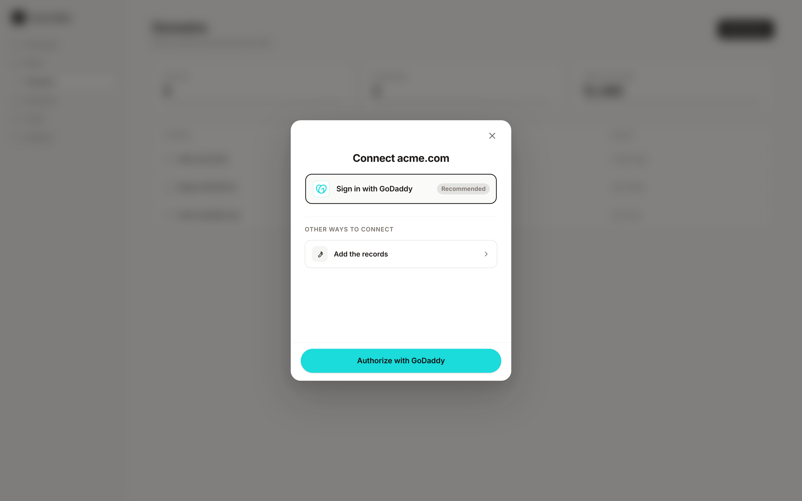
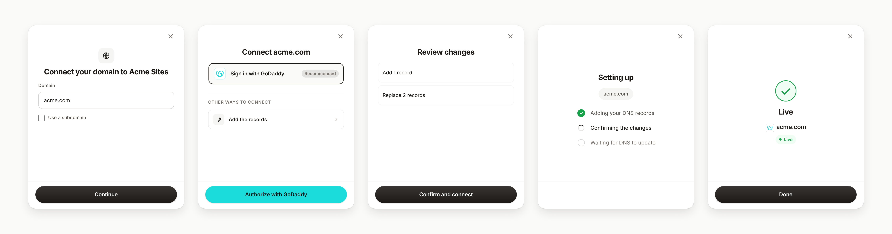
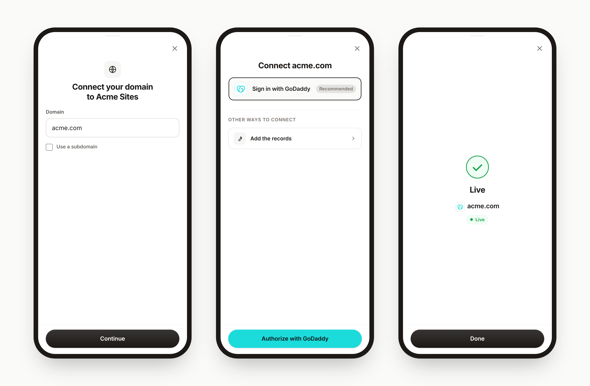
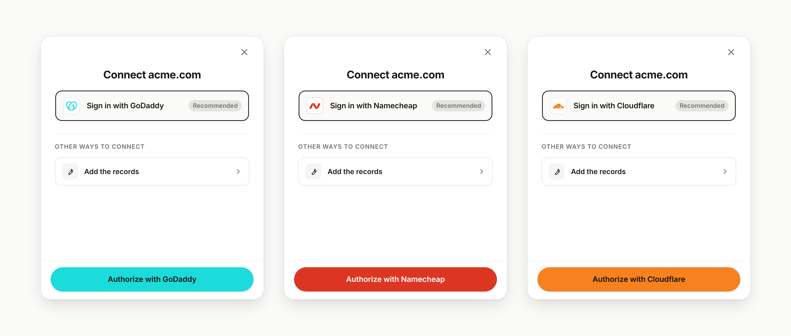
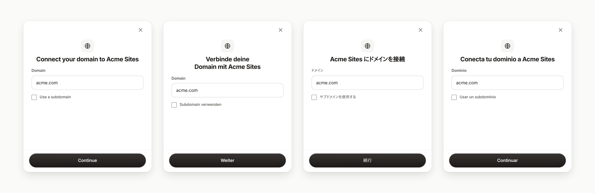
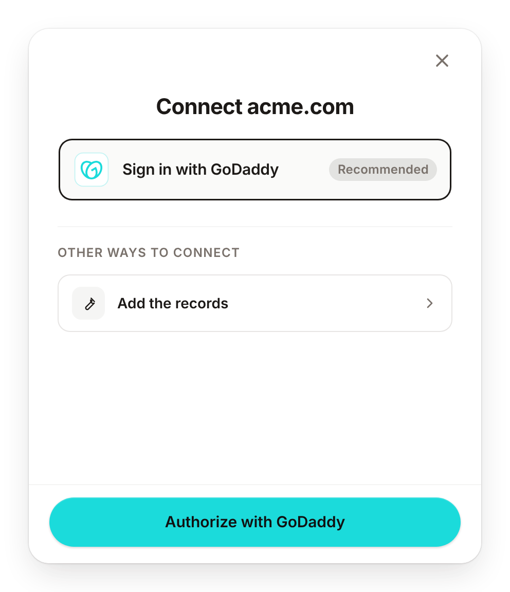

<!-- The CUSTOM-DOMAIN-APP organization front page (.github/profile/README.md). Source: docs/product/github-org/ in
     the product repo; scripts/github-org-tidy.sh copies this file and the pictures beside it. Public text: say what a
     customer needs, never how the product works inside. -->

  <picture>
    <source media="(prefers-color-scheme: dark)" srcset="https://raw.githubusercontent.com/CUSTOM-DOMAIN-APP/.github/HEAD/profile/images/customdomain-mark-dark.png">
    
  </picture>

<h1 align="center">CustomDomain™</h1>

<b>Your users connect their own domain, inside your product.</b>

  
  
  
  

  <picture>
    <source media="(prefers-color-scheme: dark)" srcset="https://raw.githubusercontent.com/CUSTOM-DOMAIN-APP/.github/HEAD/profile/images/widget-hero-dark.png">
    
  </picture>

## Who it is for

Software companies whose customers bring a domain: website and store builders, link and booking pages, creator tools,
portals and any product that gives each customer a site. You add one widget; your customer types their domain, signs
in at their provider, and it goes live on your product with HTTPS.

## How it works

| | Step | You do |
|:-:|---|---|
| **1** | **Try the widget** | Open it in the Sandbox with a made up domain. No card |
| **2** | **Add it to your product** | Your server mints a short lived token; the widget opens with it |
| **3** | **Point domains at your app** | Tell us where your users' domains should go |
| **4** | **Your user connects** | They type their domain, sign in at their provider, done |

## The widget

  <picture>
    <source media="(prefers-color-scheme: dark)" srcset="https://raw.githubusercontent.com/CUSTOM-DOMAIN-APP/.github/HEAD/profile/images/widget-flow-dark.png">
    
  </picture>

<table>
  <tr>
    <td width="50%" align="center">
      <picture>
        <source media="(prefers-color-scheme: dark)" srcset="https://raw.githubusercontent.com/CUSTOM-DOMAIN-APP/.github/HEAD/profile/images/widget-phone-dark.png">
        
      </picture>
       <b>On every screen</b>
    </td>
    <td width="50%" align="center">
      
       <b>Knows the provider</b>
    </td>
  </tr>
  <tr>
    <td width="50%" align="center">
      
       <b>Speaks your user's language</b>
    </td>
    <td width="50%" align="center">
      <picture>
        <source media="(prefers-color-scheme: dark)" srcset="https://raw.githubusercontent.com/CUSTOM-DOMAIN-APP/.github/HEAD/profile/images/widget-card-dark.png">
        
      </picture>
       <b>Wears your brand</b>
    </td>
  </tr>
</table>

## Works with the providers your users already have

  <picture>
    <source media="(prefers-color-scheme: dark)" srcset="https://raw.githubusercontent.com/CUSTOM-DOMAIN-APP/.github/HEAD/profile/images/providers-strip-dark.png">
    
  </picture>

## Install

| | | |
|:-:|---|---|
| <picture><source media="(prefers-color-scheme: dark)" srcset="https://cdn.simpleicons.org/npm/e7e5e4"></picture> | **Widget** | `npm install customdomain-js` |
| <picture><source media="(prefers-color-scheme: dark)" srcset="https://cdn.simpleicons.org/react/e7e5e4"></picture> | **React** | `npm install @customdomain/react` |
| <picture><source media="(prefers-color-scheme: dark)" srcset="https://cdn.simpleicons.org/homebrew/e7e5e4"></picture> | **Command line** | `brew install custom-domain-app/tap/customdomain` |
| <picture><source media="(prefers-color-scheme: dark)" srcset="https://cdn.simpleicons.org/claude/e7e5e4"></picture> | **AI coding tools** | `https://mcp.customdomain.ai/mcp` |

## Pricing

| Starter | Startup | Growth | Premium | Enterprise |
|:-:|:-:|:-:|:-:|:-:|
| **$10** a month | **$149** a month | **$649** a month | Talk to us | Talk to us |
| 10 domains a year | 600 a year | 600 a year, then metered | 12,000 a year | 12,000 a year, then metered |

<a href="https://customdomain.ai/pricing">See every plan</a> · The Sandbox is free

## Repositories

| | Repository | |
|:-:|---|---|
| <picture><source media="(prefers-color-scheme: dark)" srcset="https://cdn.simpleicons.org/npm/e7e5e4"></picture> | [customdomain-sdk](https://github.com/CUSTOM-DOMAIN-APP/customdomain-sdk) | The widget for JavaScript, TypeScript and React |
| <picture><source media="(prefers-color-scheme: dark)" srcset="https://cdn.simpleicons.org/gnubash/e7e5e4"></picture> | [customdomain-cli](https://github.com/CUSTOM-DOMAIN-APP/customdomain-cli) | The command line |
| <picture><source media="(prefers-color-scheme: dark)" srcset="https://cdn.simpleicons.org/homebrew/e7e5e4"></picture> | [homebrew-tap](https://github.com/CUSTOM-DOMAIN-APP/homebrew-tap) | Install the command line with Homebrew |
| <picture><source media="(prefers-color-scheme: dark)" srcset="https://cdn.simpleicons.org/claude/e7e5e4"></picture> | [customdomain-mcp](https://github.com/CUSTOM-DOMAIN-APP/customdomain-mcp) | Build your integration from an AI coding tool |
| <picture><source media="(prefers-color-scheme: dark)" srcset="https://cdn.simpleicons.org/readthedocs/e7e5e4"></picture> | [docs](https://github.com/CUSTOM-DOMAIN-APP/docs) | Source of docs.customdomain.ai |
| <picture><source media="(prefers-color-scheme: dark)" srcset="https://cdn.simpleicons.org/github/e7e5e4"></picture> | [custom-domain-checks](https://github.com/CUSTOM-DOMAIN-APP/custom-domain-checks) | Free checks for a GitHub Pages domain |
| <picture><source media="(prefers-color-scheme: dark)" srcset="https://cdn.simpleicons.org/awesomelists/e7e5e4"></picture> | [awesome-custom-domains](https://github.com/CUSTOM-DOMAIN-APP/awesome-custom-domains) | A curated list about custom domains |

## Links

  <a href="https://customdomain.ai">Website</a> ·
  <a href="https://docs.customdomain.ai/docs">Docs</a> ·
  <a href="https://docs.customdomain.ai/docs/api-reference">API reference</a> ·
  <a href="https://docs.customdomain.ai/docs/changelog">Changelog</a> ·
  <a href="https://status.customdomain.ai">Status</a> ·
  <a href="https://www.npmjs.com/package/customdomain-js">npm</a> ·
  <a href="https://www.producthunt.com/products/custom-domain">Product Hunt</a>

  Help: <a href="mailto:connect@customdomain.ai">connect@customdomain.ai</a> ·
  Security: <a href="mailto:security@customdomain.ai">security@customdomain.ai</a>, please never in a public issue

CustomDomain™ is a product of EverJust Company.

